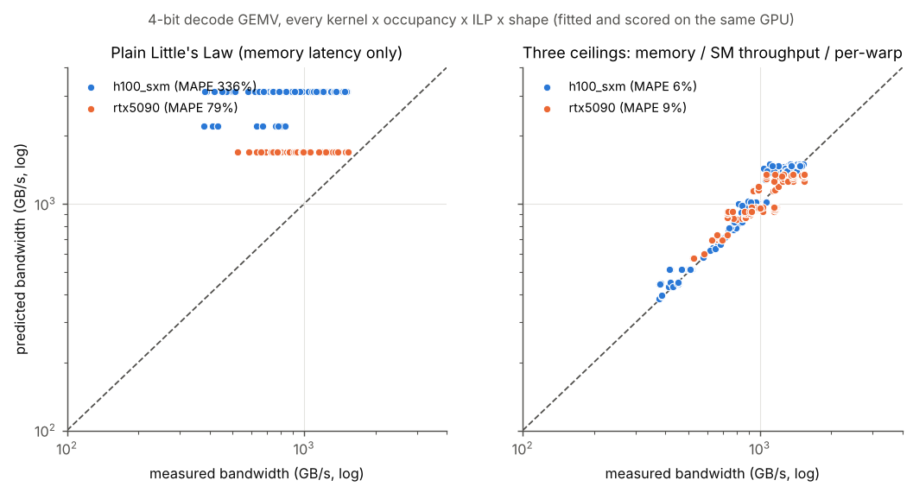
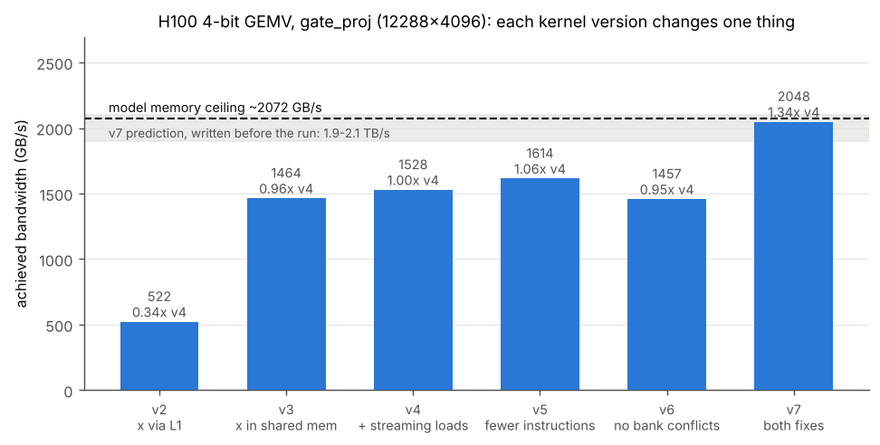
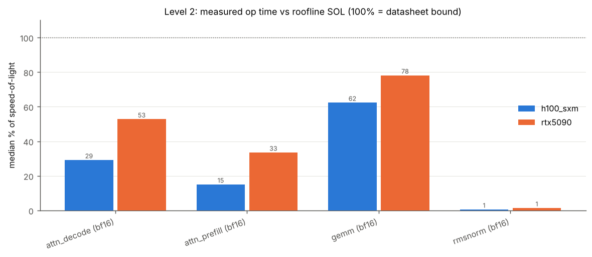
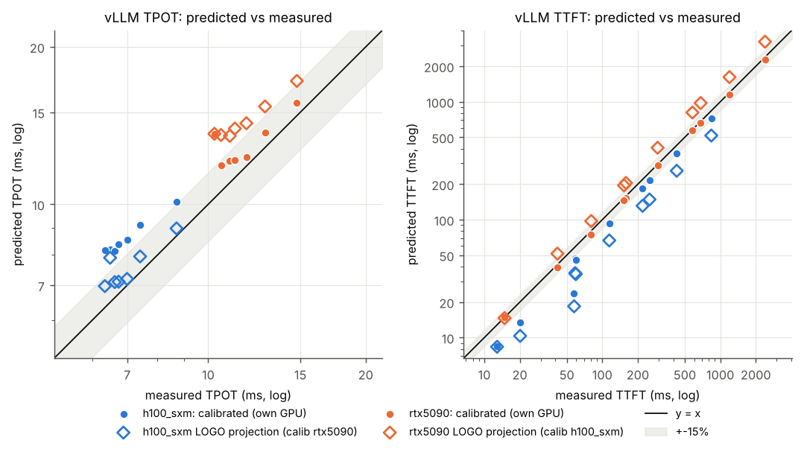
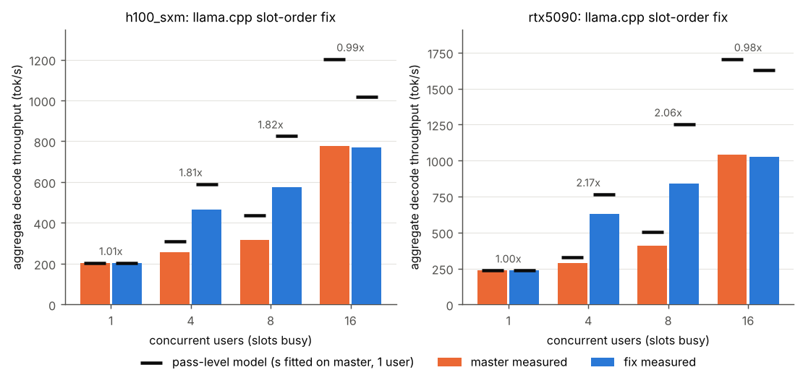

# llm-decode-perf-model: from warps to tokens/s

A three-level performance model of LLM decode on NVIDIA GPUs, checked against measurements on an
**H100 SXM** and an **RTX 5090**. Every level is scored two ways: calibrated and tested on the same GPU,
and leave-one-GPU-out (LOGO), where parameters fitted on one GPU predict the other.

All numbers below come from `data/` (raw measurements, Oct 29 2026) through the scripts in this repo.
Projections are labelled as projections.

## Results at a glance

| Level | What is predicted | Same GPU | LOGO (fit on one, predict the other) |
|---|---|---|---|
| 1. Microarchitecture | achieved bandwidth of 4-bit decode GEMV kernels (314 kernel × occupancy × ILP × shape configs) | MAPE 6.2% (H100), 9.1% (5090) | 10.7% (H100→5090), 18.9% (5090→H100) |
| 1b. Kernel optimization | GEMV bandwidth after removing the bottlenecks Nsight Compute found | H100: v7 2048 GB/s, 1.34x over v4 (predicted 1.9–2.1 TB/s before the run) | RTX 5090: 1.02x (predicted 0.95–1.10x before the run) |
| 2. Operators | bf16 GEMM time per shape | 0.6% / 1.0% (curve fit) | 18.1% / 21.7% |
| 3a. Serving, vLLM | time per output token, batch 1–64 | 23.4% (H100), 11.3% (5090) | 8.3% (5090→H100), 23.6% (H100→5090) |
| 3b. Serving, llama.cpp | throughput gain of a slot-scheduling fix at 4 and 8 users | +4.0 to +5.3% (H100), +7.8 to +20.7% (5090) | n/a |

## Level 1: what limits a 4-bit decode GEMV on the H100

`kernels/gemv_sweep.cu` holds hand-written 4-bit GEMV kernels (symmetric int4 in 32-weight groups with an
fp16 scale: 18 bytes per group, 4.5 bits per weight). Each version changes one thing:

| kernel | change |
|---|---|
| v2 | one warp per row, 16-byte vector loads, x read through L1 |
| v3 | x staged in shared memory once per block, persistent grid |
| v4 | v3 + streaming (evict-first) weight loads |
| v5 | v4 with an int4 → fp16 bit trick instead of int → float conversions (half the instructions) |
| v6 | v4 with x swizzled in shared memory (no bank conflicts) |
| v7 | both v5 and v6 |

The sweep runs every kernel across blocks per SM, loads in flight per thread (ILP 1/2/4) and three Qwen3-8B
projection shapes (4096x4096, 12288x4096, 4096x12288), with a correctness check against a CPU reference.
Probes measure DRAM latency (pointer chase) and peak stream bandwidth.

### Starting point: the same kernel, two GPUs

| GPU | stream peak | v2 | v3 | v4 (best) | v4 % of peak |
|---|---|---|---|---|---|
| H100 SXM | 3141 GB/s | 518 | 1455 | 1525 GB/s | 49% |
| RTX 5090 | 1700 GB/s | 923 | 1386 | 1538 GB/s | 90% |

v4 reaches 90% of peak on the 5090 but only 49% on the H100. Plain Little's Law (bandwidth = bytes in
flight / latency, capped at peak) over-predicts the H100 by 336% on average (79% on the 5090): more bytes
in flight do not help, so something on the SM side is the limit.

**Machine balance.** The memory system delivers 3141 GB/s / (132 SMs × 1.98 GHz) = **12.0 bytes per SM
per cycle** on the H100, but only 1700 / (170 × 2.89) = **3.5** on the 5090. A fixed SM cost per 18-byte
group is hidden on the 5090 and exposed on the H100.

**Three-ceiling model** (`perfsim/gemv_model.py`):

```
BW = min( BW_mem  = loaded-latency Little's Law (latency and peak from the probes),
          BW_sm   = SMs × f_SM × bytes_per_group / cpg,          cpg = SM cycles per group
          BW_warp = warps/SM × SMs × f_SM × bytes_per_group / cpw ) cpw = per-warp cycles per group
t   = t0 + bytes / BW                                             t0  = launch cost
```

cpg, cpw and t0 are fitted per kernel and ILP; f_SM is the measured busy SM clock.



| fitted on | predicted on | configs | MAPE | max error | Pearson r | bound (mem / SM / warp) |
|---|---|---|---|---|---|---|
| H100 | H100 | 168 | 6.2% | 37.6% | 0.978 | 0 / 123 / 45 |
| H100 | RTX 5090 (LOGO) | 146 | 10.7% | 32.9% | 0.884 | 89 / 45 / 12 |
| RTX 5090 | H100 (LOGO) | 168 | 18.9% | 44.5% | 0.949 | 0 / 141 / 27 |
| RTX 5090 | RTX 5090 | 146 | 9.1% | 26.4% | 0.907 | 77 / 45 / 24 |

The model says *that* the H100 kernels are SM-limited (fitted cpg ≈ 2.4–2.5 cycles per group for v4), not
*which* SM resource. The next three steps found out, on an H100 with Nsight Compute counters enabled
(Lium, evening of Oct 29 2026 Pacific time; raw data in `data_kernels/`).

### Step 1: predict, then measure (v5). The prediction was wrong.

The obvious suspect was instruction count. The compiled SASS (`microarch/sass_count.py`) shows v4 executes
about 205 instructions per lane per group, including 32 int → float conversions. v5 replaces them with an
fp16 bit trick (OR the 4-bit value into the mantissa of 1024.0, one HSUB2, then HFMA2 on two weights at
once): about 86 instructions. Scaling v4's fitted cpg by that ratio, the model predicted **1.35x** on the
best gate_proj config (`results/v5_prediction.md`, written before v5 ran). Measured: **1.05x**
(1526 → 1604 GB/s; `results/v5_score_h100_sxm.md`).

### Step 2: Nsight Compute shows why: shared-memory bank conflicts

Full Nsight Compute profiles of the best config of each kernel (`results/ncu_deep_h100_lium.md`; shared-memory
counters from `data_kernels/*/ncu_deep/*.raw.csv`, summarized in `results/h100_kernel_ladder.md`):

- v5 halved executed instructions (7.23 → 3.62 warp instructions per group) and issue-slot use (64% → 32%),
  so instruction issue was not the only limit. No execution pipe was saturated (ALU 57% in v4).
- v3, v4 and v5 make **4x the shared-memory load wavefronts** that a conflict-free layout needs (3.15M on
  gate_proj vs 0.79M measured for v6/v7 below), with 2.36M bank conflicts: a 4-way conflict on every read of x. Lane l handles group g = l + 32j and reads its 16-byte chunks of x
  at byte offset 64g, so the 8 lanes of a quarter-warp land on only 2 of the 8 16-byte bank slots.
- The top warp stall is "short scoreboard" (waiting on shared memory), 7.2 warps per issue in v4 and 11.4
  in v5.

### Step 3: remove the conflicts (v6, v7), predict again, measure

v6 and v7 store chunk c of x at `swz(c) = (c & ~7) | ((c & 7) ^ ((c >> 3) & 3))`, which keeps each group's
four chunks in one 128-byte line and gives the 8 lanes of a quarter-warp 8 different slots
(`tests/test_gemv_model.py` checks this). Before running, the prediction was: v7 reaches the model's memory
ceiling, **1.9–2.1 TB/s**; v6 lands between v4 and v7 (`results/v6v7_prediction.md`).



H100, gate_proj (12288x4096), best config per kernel (`results/h100_kernel_ladder.md`):

| kernel | GB/s | vs v4 | % of peak | warp instr / group | issue busy | shared wavefronts | stall: shared mem | stall: DRAM | occupancy | regs |
|---|---|---|---|---|---|---|---|---|---|---|
| v4 | 1528 | 1.00x | 49% | 7.23 | 64% | 3,145,728 | 7.19 | 5.78 | 70% | 40 |
| v5 (fewer instructions) | 1614 | 1.06x | 51% | 3.62 | 32% | 3,146,218 | 11.42 | 8.58 | 48% | 42 |
| v6 (no bank conflicts) | 1457 | 0.95x | 46% | 7.67 | 64% | 786,432 | 0.29 | 3.61 | 34% | 58 |
| **v7 (both)** | **2048** | **1.34x** | **65%** | 4.31 | 47% | 786,948 | 0.41 | 9.58 | 46% | 58 |

- **v7 reached 2048 GB/s, inside the predicted range and 99% of the model's memory ceiling (2072 GB/s).** That
  ceiling is set by v7's bytes in flight, not by the hardware: cuBLAS reaches 88% of peak (below).
  Its top stall is now waiting on DRAM ("long scoreboard"), as it should be for a memory-bound kernel.
- **The kernel had two limits at once.** Removing either one alone gives at most 1.06x; removing both gives 1.34x.
- **My v6 prediction was wrong.** v6 ran slower than v4. It uses more registers (58 vs 43 for v4 at ILP 4),
  which caps it at 4 blocks per SM, and its fastest config runs at 34% occupancy against v4's 70%, with
  waiting on DRAM as the top stall. Fewer resident warps to hide memory latency is the likely cause; I have
  not isolated it.
- On the smallest shape (q_proj, 4096x4096) v7 gains 1.15x (1075 → 1234 GB/s); at 10 µs per kernel the
  fixed launch and tail cost is a larger share.
- The same configs on two different H100 hosts (Vast and Lium) agree: v4 best 1525 vs 1528 GB/s.

### Step 4: check it (repeats, a cuBLAS baseline, and the RTX 5090)

Three more runs on the evening of Oct 29, Pacific time (`data_kernels/h100_vast2`, `data_kernels/rtx5090_lium`; `results/extra_*.md`):

- **Repeatable.** On a third H100 host, the full sweep three times: v7 gate_proj 2049 GB/s (2010–2069),
  v4 1534 (1508–1553). The best config of every kernel and shape varies by at most 3.2% (H100) and 0.6% (5090).
- **cuBLAS baseline** (fp16 dense GEMV on the dequantized weights, `kernels/q4gemv.cu`, same shapes):

| GPU | shape | cuBLAS fp16 | % of peak | v7 (4-bit) | % of peak | time per call, v7 vs cuBLAS |
|---|---|---|---|---|---|---|
| H100 | gate_proj | 2761 GB/s | 88% | 2049 GB/s | 65% | 13.8 vs 36.5 us (2.6x faster) |
| H100 | down_proj | 2627 GB/s | 84% | 1713 GB/s | 55% | 16.6 vs 38.3 us (2.3x faster) |
| H100 | q_proj | 2038 GB/s | 65% | 1263 GB/s | 40% | 7.5 vs 16.5 us (2.2x faster) |
| RTX 5090 | gate_proj | 1726 GB/s | 103% | 1601 GB/s | 95% | 17.7 vs 58.3 us (3.3x faster) |

v7 is faster per call because it reads 3.6x fewer bytes, but on the H100 it uses the memory system less
efficiently than cuBLAS: 65% of peak against 88%. That gap is the next thing to close (v7 runs at 46%
occupancy with 58 registers, so it has fewer bytes in flight). On the 5090 v7 is within 8 points of cuBLAS.
cuBLAS at 103% means the stream probe reads slightly below the 5090's true peak.

- **The same fix on the RTX 5090: 1.02x, as predicted** (`results/rtx5090_v7_prediction.md`, written before the
  run: 0.95–1.10x). gate_proj: v4 1562, v5 1578, v6 1545, v7 1601 GB/s. Nsight Compute on the 5090
  (`results/ncu_deep_rtx5090_lium.md`) shows the same 4-way bank conflicts as on the H100 (2.36M on v4), but
  there warps wait on DRAM (long scoreboard 15.2 warps per issue) and hardly on shared memory (1.0). The
  same defect costs 1.34x on one GPU and almost nothing on the other, which is the machine-balance argument
  from the start of this section, measured.

What this means for the model: cpg is a lumped SM-side cost. The counters split it into two resources that
limit at the same time, shared-memory wavefronts and instruction count, and an occupancy effect from
registers. Modelling each explicitly is the next step.

## Level 2: operators

`bench/ops_bench.py` times every GEMM, attention and norm shape of a Qwen3-8B layer in PyTorch with a
cold L2 (206 shapes on H100, 205 on 5090). Median % of speed-of-light (max of FLOPs / datasheet peak and
bytes / datasheet bandwidth):

| op | H100 | RTX 5090 |
|---|---|---|
| GEMM (bf16) | 62% | 78% |
| decode attention | 29% | 53% |
| prefill attention | 15% | 33% |
| RMSNorm | 0.5% | 1.4% |



The operator model is roofline divided by an efficiency curve fitted per op class. Curves fitted on one
GPU predict the other's GEMMs to within 18–22% MAPE.

## Level 3a: vLLM

`vllm bench latency` (vLLM 0.32.0, Qwen3-8B bf16, input 512, batch 1–64; TTFT also at input
128–8192). TPOT = (latency at 128 output tokens − latency at 1) / 127. Measured TPOT at batch 1:
6.49 ms (H100), 10.28 ms (5090).

| GPU | metric | calibrated on own GPU | LOGO |
|---|---|---|---|
| H100 | TPOT | 23.4% (over-predicted by 16 to 29%) | 8.3% |
| H100 | TTFT | 24.6% (under-predicted) | 43.5% |
| RTX 5090 | TPOT | 11.3% | 23.6% |
| RTX 5090 | TTFT | 3.5% | 29.4% |



The 5090 is modelled well. On the H100 the model is too slow for decode and too fast for prefill. The
likely cause is that the calibration comes from standalone `torch.matmul` calls, while vLLM runs
different fused kernels inside CUDA graphs. This is not verified, because kernel-level counters were not
available on the rented machines (see Limitations).

## Level 3b: a llama.cpp scheduling bug, measured on both GPUs

In `llama-server` with one KV stream per slot, a decode batch can only contain consecutive slot ids, and
least-recently-used slot assignment scatters the busy slots. One generation step then becomes several
forward passes, each re-reading all the weights. A small change to slot selection
(`bench/llamacpp/patches/slot_order.patch`, from [SpecEdge](https://github.com/Rushil-Nair/SpecEdge)) keeps
busy slots contiguous.

Qwen3-8B Q4_K_M, 16 slots, 100 requests per run, closed loop:

| users | H100 master → fix | passes per step | RTX 5090 master → fix | passes per step |
|---|---|---|---|---|
| 1 | 202 → 204 tok/s (1.01x) | 1.00 → 1.00 | 237 → 237 (1.00x) | 1.00 → 1.00 |
| 4 | 258 → 467 (**1.81x**) | 2.79 → 1.03 | 290 → 629 (**2.17x**) | 2.93 → 1.01 |
| 8 | 317 → 576 (**1.82x**) | 3.81 → 1.12 | 408 → 842 (**2.06x**) | 3.53 → 1.08 |
| 16 | 775 → 770 (0.99x) | 1.49 → 1.76 | 1043 → 1026 (0.98x) | 1.49 → 1.58 |

At 16 users all slots are busy, so they are contiguous anyway and the fix has nothing to fix.

The mechanism shows up in two places at 8 users. In the server's own step statistics (full 100-request runs),
decode steps that reused a CUDA graph went from 6% to 90% (H100) and from 5% to 93% (5090). In Nsight
Systems captures of about 20 s, master issued 5.2x (H100) and 4.4x (5090) more individual kernel launches
than the fix.

**Pass-level model** (`perfsim/slot_pass_model.py`):

```
t_step = k × t_pass(users / k) + s
```

- t_pass(B) is llama.cpp's own per-pass decode time from `llama-batched-bench`.
- k is the measured passes per step.
- s is one per-step server cost, fitted on the 1-user master run only.

| GPU | users | measured speedup | predicted | error |
|---|---|---|---|---|
| H100 | 4 | 1.81x | 1.90x | +5.3% |
| H100 | 8 | 1.82x | 1.89x | +4.0% |
| RTX 5090 | 4 | 2.17x | 2.34x | +7.8% |
| RTX 5090 | 8 | 2.06x | 2.49x | +20.7% |



Absolute tok/s is over-predicted by 13–64%. The model leaves out prefill of new requests (prompt cache off)
and users that are idle between requests; that is the likely cause, not yet tested. The fix/master ratio
cancels most of it. The first version of this
model built the step from Level 2 op costs, which are not calibrated for Q4_K kernels, and it
over-predicted the speedup by 31–77% (`results/correlation.md`).

## Automated check loop

`agents/pipeline.py` runs fit → correlate → flag every prediction off by more than 15% and writes a
diagnosis to `results/AGENT_LOG.md`. On this data it flags all 18 Level 1 kernel × ILP groups as
over-predicted by plain Little's Law, with the suggestion "outstanding loads are capped below warps x ILP
(registers, MSHR/LSU slots) or loaded latency grows faster than the queueing term (alpha too small)". The
three-ceiling model adds an explanation the pipeline does not suggest (an SM-side cost), and Nsight Compute
then identified that cost as shared-memory bank conflicts plus instruction count (Level 1).

## Repository

```
kernels/        4-bit GEMV CUDA kernels (q4gemv.cu: v0-v4 + cuBLAS reference; gemv_sweep.cu: v2-v7, occupancy x ILP)
microarch/      latency / bandwidth probes, SASS instruction counter, Nsight Compute report parser
perfsim/        models: microarch.py + gemv_model.py (L1), v5_prediction.py + kernel_ladder.py (kernel work),
                ops_model.py (L2), engine.py + slot_pass_model.py (L3)
bench/          GPU-side benchmarks: run_microarch.sh, run_ncu_deep.sh, ops_bench.py, run_vllm.sh, llamacpp/
correlate/      predicted vs measured, MAPE / max error / Pearson r, leave-one-GPU-out, per-op attribution
whatif/         projections: HBM bandwidth, SM count, FP8 weights, TP=2 over NVLink
agents/         fit -> correlate -> flag -> AGENT_LOG.md
data/           raw measurements per GPU (env, clocks, probes, sweeps, vLLM, llama.cpp logs, nsys)
data_kernels/   H100 kernel runs with Nsight Compute (sweeps, per-config counters, full profiles: .ncu-rep + CSV)
results/        every table above, as markdown and CSV
figures/        plots generated from results/
gpu/run_all.sh  single entry point on a rented GPU (about 2 h)
```

## Reproduce

No GPU needed for the analysis:

```
pip install -r requirements.txt
python -m pytest -q                                   # tests on synthetic data
python bench/fit_calib.py --data data/h100_sxm        # and data/rtx5090
python -m correlate.correlate --data data --out results
python -m perfsim.gemv_model --data data --out results
python -m perfsim.slot_pass_model --data data --out results
python -m perfsim.v5_prediction --out results --score data_kernels/h100_lium --gpu h100_sxm
python -m perfsim.kernel_ladder --run data_kernels/h100_lium2 --out results
python microarch/ncu_deep_report.py data_kernels/h100_lium2 results/ncu_deep_h100_lium2.md
python -m perfsim.extra_report data_kernels/h100_vast2 results/extra_h100_vast2.md
python -m whatif.sweeps --gpu h100_sxm
python -m figures.make_figures --results results --out figures
```

New measurements on an Ubuntu GPU machine: `bash gpu/run_all.sh`. Kernel sweep + Nsight Compute only (needs
a host that allows GPU performance counters): `GPU_TAG=h100_x ONLY="micro deep" bash gpu/run_all.sh`;
repeats + cuBLAS baseline: `ONLY="micro extra"`.

## Limitations

- Two GPUs. This is post-silicon correlation, not a cycle-level simulator, and the what-ifs are
  first-order projections.
- Nsight Compute counters were blocked on the first two rented hosts (`ERR_NVGPUCTRPERM`, see
  `data/*/ncu_probe.txt`). The kernel work in Level 1 used a second H100 (Lium) with counters enabled
  (`data_kernels/`), and a Lium RTX 5090 with counters for the v2-v7 profiles.
- Clocks were logged at 1 Hz but not locked. Each timing is 100 launches; the sweep was repeated 3 times on
  `h100_vast2` and `rtx5090_lium` (spread of the best config at most 3.2%), and the best config of each kernel
  and shape differs by less than 1.4% between the two Lium H100 runs.
- The fix/master gain at 8 users on the RTX 5090 was 2.63x on Oct 8 (200-request mix, earlier llama.cpp
  commit) and 2.06x here (first 100 requests, commit `7182ef7`). Both are reported.

## License

MIT
